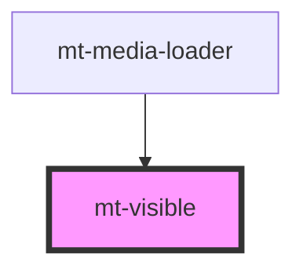

# mt-visible

<!-- Auto Generated Below -->

## Properties

| Property  | Attribute | Description | Type                           | Default |
| --------- | --------- | ----------- | ------------------------------ | ------- |
| `visible` | `visible` |             | `"false" \| "true" \| boolean` | `true`  |

## Dependencies

### Used by

 - [mt-media-loader](../../../components/mt-media-loader)

### Graph

----------------------------------------------

*Built with [StencilJS](https://stenciljs.com/)*
